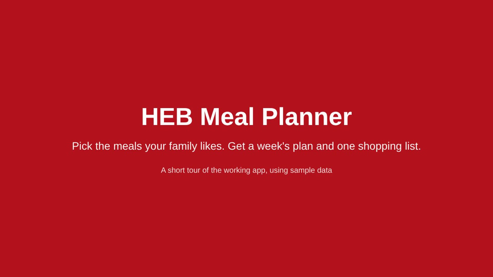
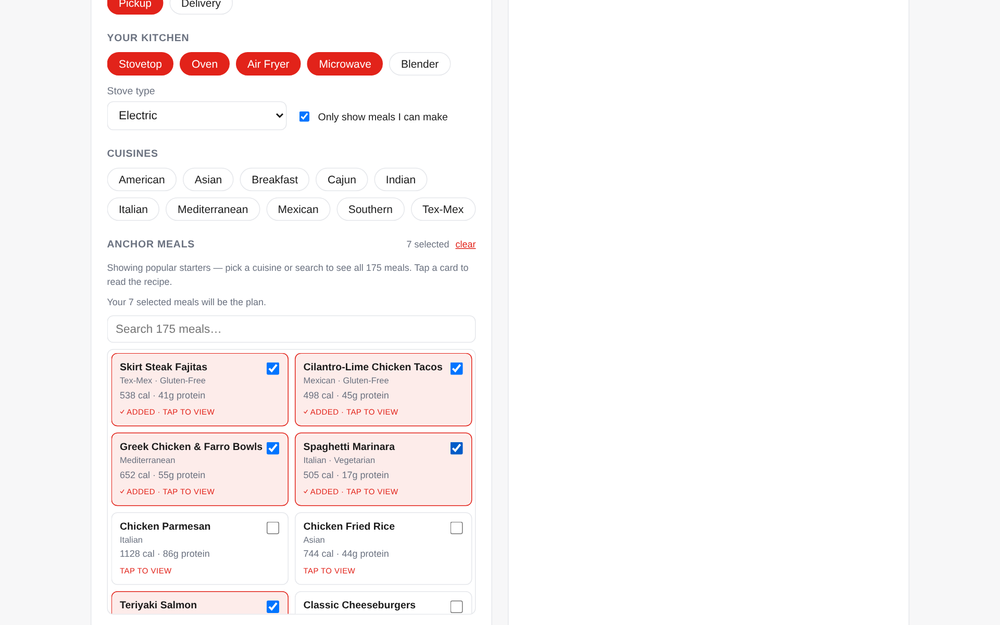
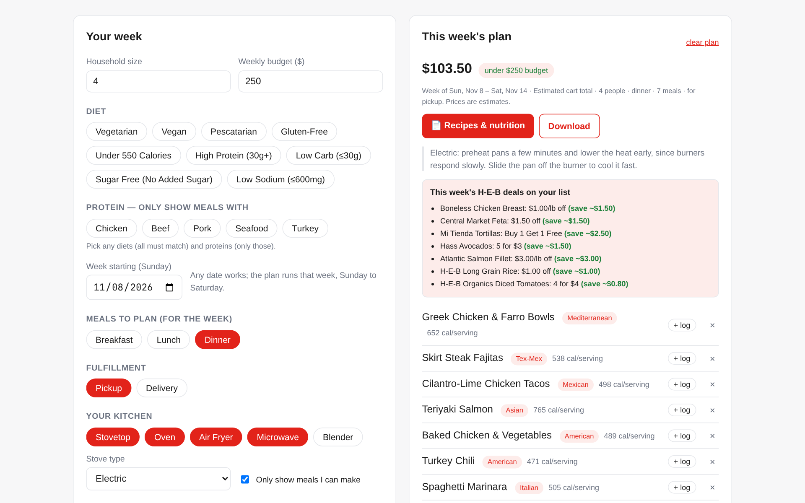
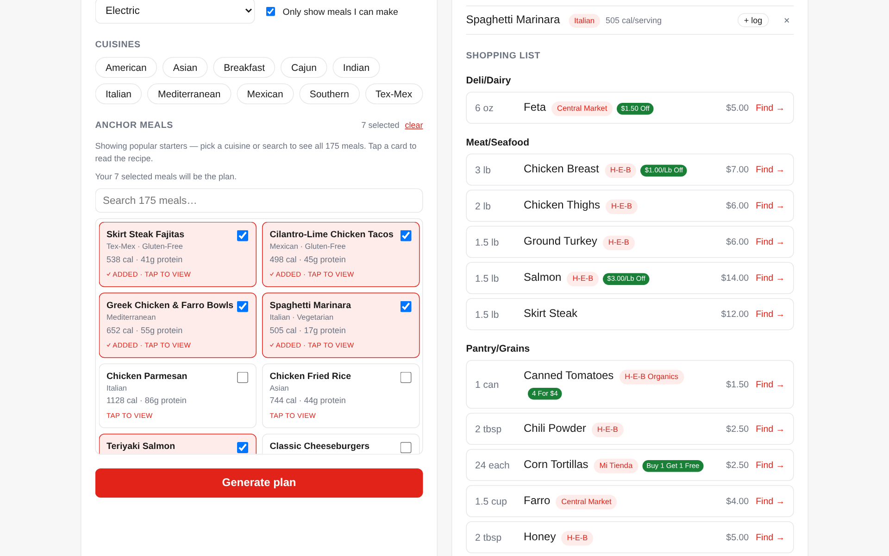
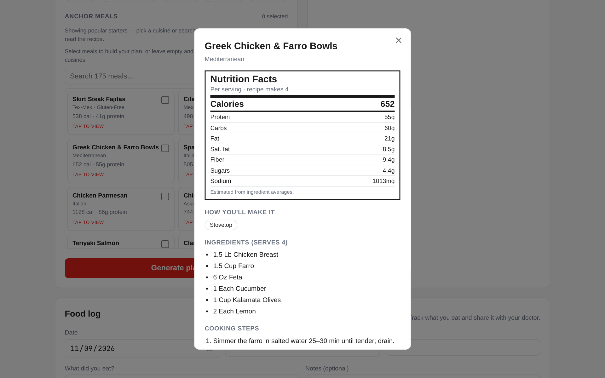
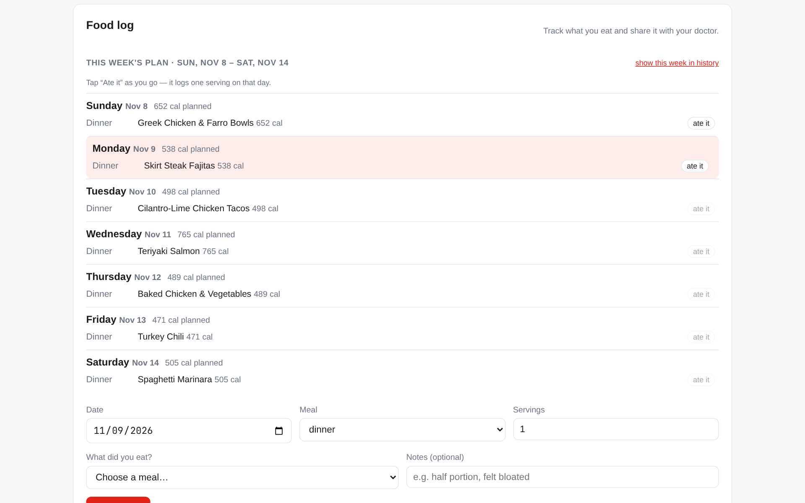
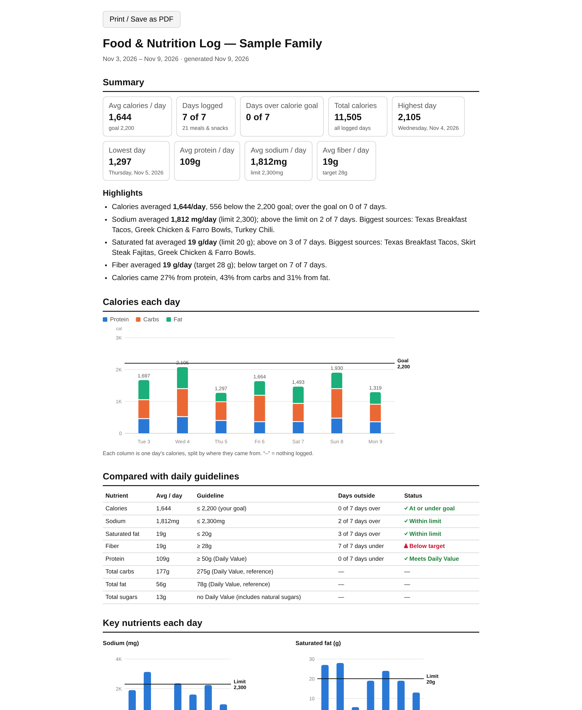

<h1 align="center">🛒 HEB Meal Planner</h1>

<p align="center">
  <em>Plan your family's week in H-E-B's own language — pick the meals you love,
  get one consolidated shopping list mapped to real H-E-B products, on budget.</em>
</p>

<p align="center">
  
  
  
  
  
  
</p>

---

## See it running

**[Try the live demo](https://jordanistan.github.io/heb-meal-planner/app/)** or **[▶ watch the 90-second tour](https://jordanistan.github.io/heb-meal-planner/#tour)**. No install needed.

[](https://jordanistan.github.io/heb-meal-planner/#tour)

| Choose your meals | Get the week's plan and cost |
|---|---|
|  |  |
| **One shopping list, by department** | **Full recipe with nutrition facts** |
|  |  |
| **Sunday–Saturday schedule** | **Report to share with a doctor** |
|  |  |

<sub>Captured from the working app using sample data. Prices and deals are examples.</sub>

---

## What is this?

Most meal-plan apps hand you recipes and a generic list. **HEB Meal Planner** is
built for Texas families who already shop at H-E-B: it plans the week around your
**anchor meals** and diet, then turns every ingredient into the *right H-E-B
product* — favoring private labels like **Mi Tienda**, **Central Market**, and
**H-E-B Organics** — with a one-tap deep link to buy.

- 🍽️ **175 recipes across 10 cuisines** (12–24 each, incl. low-carb options) — Mediterranean, Mexican, Tex-Mex, Italian, Asian, Indian, American, Southern, Cajun, Breakfast — every one with cooking steps.
- 🔥 **Cook with what you have** — tell it your kitchen (stovetop, oven, air fryer, microwave, blender) and stove type (induction, gas, electric, none). Plans only suggest meals you can make, and oven recipes come with air-fryer instructions (and vice versa).
- 📊 **Nutrition Facts** for every recipe (per-serving estimates), plus "under 550 calories" and "high protein" filters.
- 📄 **Printable recipe book** for each plan — scaled recipes, steps, and a Nutrition Facts label per meal.
- 🗓️ **Sunday–Saturday schedule** — every plan lays its meals out by day and meal (breakfast slots get breakfast recipes); tap "ate it" in the food log as the week goes.
- 📓 **Food log + doctor report** — log what you ate each day (planned meals or custom foods) and set a calorie goal. The report does the math and draws the charts: daily calories split by protein/carbs/fat vs your goal, sodium / saturated fat / fiber / protein vs daily guidelines, calories by meal, your most-eaten foods, highs, lows and averages, plus the day-by-day log and recipes. Print or save as PDF, or export CSV.
- 🎯 **Anchor meals + smart auto-fill** — lock in your go-to dinners, we fill the rest of the week.
- 🧾 **Consolidated shopping list** — "2 limes + 3 limes = 5 limes," grouped by store department.
- 🏷️ **H-E-B brand intelligence** — maps `skirt steak` → *Mi Tienda Seasoned Beef Fajitas*, `feta` → *Central Market Greek Feta*.
- 💵 **Budget mode** — "I want to spend $X" and the plan fits.
- 🎟️ **Weekly-ad coupons** — deals on your list, with estimated savings.
- 🥗 **Diet & protein filters (multi-select)** — combine diets (vegetarian, vegan, gluten-free, pescatarian, low-calorie, high-protein, low-carb ≤30g, no added sugar, low-sodium ≤600mg; all must match) with "only these proteins" (e.g. chicken + seafood, nothing else).
- 🚚 **Pickup or delivery.**
- 🌙 **Dark mode.**

> **Privacy by design:** the "buy" step is a deep link your *own* browser follows
> to heb.com. The app never scrapes or automates H-E-B from its servers.
> Your food log and saved plans are **encrypted at rest** with a key that lives
> only in your `.env` — see [Your data & encryption](#your-data--encryption).

---

## Quick start (Docker)

The whole stack — API, web, and Postgres — comes up with one command.

```bash
git clone https://github.com/jordanistan/heb-meal-planner.git
cd heb-meal-planner
docker compose up -d --build
```

Then open:

| URL | What |
|-----|------|
| **http://localhost:3000** | 🖥️ The app |
| http://localhost:8000/docs | 🔌 API (Swagger) |

Stop it with `docker compose down` (add `-v` to wipe the database).

### Your data & encryption

Food log entries (what you ate, servings, nutrition, notes) and saved plans are
encrypted in the database. Only the date of each log entry is stored in the clear.
**Create the key once before first use:**

```bash
python -m app.crypto --init   # writes DATA_ENCRYPTION_KEY to .env (gitignored, chmod 600)
```

- **Back the key up** (e.g. in a password manager). If it's lost, the data can't be recovered.
- **Nothing personal is in git.** `.env`, database files (`*.db`) and downloaded
  reports (`food-log-*`, `meal-plan-*.html`) are gitignored. Docker keeps Postgres
  data in a volume outside the repo, and `.env` is excluded from images.
- Without a key, the app refuses to save or show log and plan data (HTTP 503)
  rather than store it unencrypted.
- **Rotate:** set `DATA_ENCRYPTION_KEY="new_key,old_key"`, run
  `python -m app.crypto --reencrypt` (or `docker compose run --rm api python -m app.crypto --reencrypt`),
  then remove the old key. The same command encrypts plans saved before encryption existed.

### Optional: Claude cooking steps

Every library recipe ships with steps. An Anthropic API key enables generated
steps for any recipe that lacks them:

```bash
echo "ANTHROPIC_API_KEY=sk-ant-..." >> .env
docker compose up -d api
```

### Run without Docker

```bash
python -m venv .venv && source .venv/bin/activate
pip install -r requirements.txt
uvicorn app.main:app --reload      # API on :8000 (SQLite by default)
pytest -q                          # 15 tests

cd frontend && npm install && npm run dev   # web on :3000
```

---

## How it works

```
Your browser ──▶ Next.js web  ──▶ FastAPI API ──▶ Claude API (optional steps)
      │                                  │
      │                                  └──▶ PostgreSQL (plans, households, cache)
      │                                  └──▶ Catalog worker (scheduled)
      └───────────────▶ heb.com   (deep links — your session, never our servers)
```

- **`app/planning/`** — the brains: recipe library, brand mapping, consolidation, pricing, coupons. Pure Python, no web/DB deps.
- **`app/`** — FastAPI service (stateless, scales horizontally).
- **`frontend/`** — Next.js app; proxies to the API server-side.
- **`k8s/`** — production manifests: API `Deployment` + `HorizontalPodAutoscaler`, Postgres, and a catalog `CronJob`.

See [`CLAUDE.md`](./CLAUDE.md) for the full architecture and conventions.

---

## API at a glance

| Method | Path | Purpose |
|--------|------|---------|
| `GET` | `/health` | Liveness + DB check |
| `GET` | `/recipes` | Recipe library (ingredients, steps, equipment, nutrition) |
| `GET` | `/recipes/{id}/steps` | Cooking steps (library, else Claude-generated + cached) |
| `GET` | `/coupons` | This week's ad coupons |
| `POST` | `/plans` | Generate a weekly plan + shopping list (`kitchen`, `stove` optional) |
| `GET` | `/plans/{id}` | Fetch a saved plan |
| `GET` | `/plans/{id}/report` | Printable recipes + Nutrition Facts (`?download=1`) |
| `POST` | `/log` | Log a meal eaten (recipe or custom food) |
| `GET` | `/log` | Meals eaten per day with totals (`start`, `end`) |
| `DELETE` | `/log/{id}` | Remove a log entry |
| `GET` | `/log/report` | Doctor report (`calorie_goal`, `name`, `format=html\|csv`) |

---

## Deploy to Kubernetes

```bash
kubectl apply -f k8s/namespace.yaml
kubectl apply -f k8s/config.yaml -f k8s/postgres.yaml -f k8s/api.yaml -f k8s/catalog-cronjob.yaml
```

Push the image to your registry and set `image:` in `k8s/api.yaml` first. Use a
managed database in production instead of the in-cluster Postgres.

---

## Roadmap

- **Pro tier — assisted cart-fill:** your API key + Claude's browser extension log into heb.com *in your browser* and load the cart, stopping before payment.
- Real catalog prices & live weekly-ad coupons via a partner feed (today's are estimates/samples).
- Multi-retailer support.

---

## Status & disclaimer

v1 / MVP. Prices and coupons are **sample/estimated data**, not live H-E-B
pricing. Not affiliated with or endorsed by H-E-B; "H-E-B", "Mi Tienda", and
"Central Market" are trademarks of their respective owner and are referenced
here only to map shopping queries.

## License

[MIT](./LICENSE)
